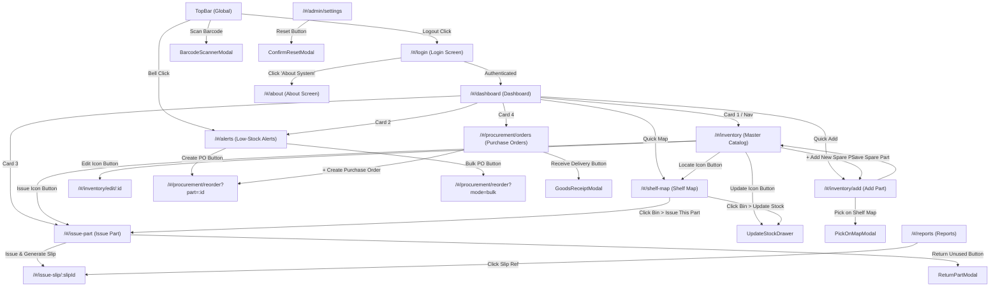

# StockSense Design Specification & Proto.io Blueprint

> **Product:** StockSense (Mechanic Spare Part Inventory & Stock Management System)  
> **Group:** Software Prototyping Group 6 — **Team Invictus**  
> **Team Members:** Yadnesh Sadavarte (`202501100006`), Aditya Bhosale (`202501100010`), Aditya Ghongde (`202501100013`)  
> **Style System:** Ultra-clean Flat Minimalist on an 8px Grid (Strictly Zero Neumorphism, Zero 3D, Zero Gradients, Zero Blur)

---

## 1. Exact Design Tokens

### 1.1 Palette (Strictly Limited to 6 Hex Values)

| Token Name | Hex Value | Semantic Usage & Contrast Rules |
| :--- | :--- | :--- |
| `--white` | `#FFFFFF` | Page canvas, card surfaces, table body background, input fields. |
| `--grey` | `#E5E5E5` | 1px dividers, card/input borders, disabled states, toggle off-track. &bull; *Sub-tint `#F2F2F2`:* Table header row background, KPI sub-boxes. &bull; *Sub-tint `#F7F7F7`:* Table row interactive hover fill. |
| `--orange` | `#FCA311` | Single accent hue: Primary button fill, active nav marker, progress bar fill, low-stock badge, notification dot. &bull; *Hover tint `#E8950F`:* 6% darker orange on hover/active. &bull; *Rule:* Never use orange text on white. Text on orange is always navy `#14213D`. |
| `--navy` | `#14213D` | Primary typography, icons, card titles, secondary button border & text, dark pill badges. |
| `--black` | `#000000` | Out-of-Stock badge fill, danger buttons, high-contrast mode border accents. |
| `--text-dim` | `#5B6478` | Secondary captions, timestamps, input placeholders, breadcrumbs (lighter tint of navy). |

> **Contrast Rule:** All interactive statuses use **Icon + Label + Palette Color**, never color alone.

---

### 1.2 Typography (Single Font Family: Inter)

* **Font Family:** `Inter`, `-apple-system`, `BlinkMacSystemFont`, `sans-serif` (Google Font supported in Proto.io).
* **Weights:** `400` (Regular), `500` (Medium), `600` (Semi-Bold), `700` (Bold).
* **Numeric Rule:** Part codes, barcodes, rack coordinates, prices, and quantities use Inter with `font-variant-numeric: tabular-nums` and `0.02em` tracking (`.code-num`).

| Type Style | Size / Line-Height | Font Weight | Tracking | Usage |
| :--- | :--- | :--- | :--- | :--- |
| **Page Title** | 28px / 36px | 700 (Bold) | `-0.02em` | Main screen header |
| **Section Title** | 20px / 28px | 600 (Semi-Bold) | `-0.01em` | Major card/grid headers |
| **Card Title** | 16px / 24px | 600 (Semi-Bold) | `0em` | Sub-panel and modal headers |
| **Body** | 14px / 20px | 400 (Regular) | `0em` | Explanations, modal text, form descriptions |
| **Table Text** | 14px / 20px | 400 (Regular) | `0em` | Table data cells |
| **Label / Caption** | 12px / 16px | 500 (Medium) | `+0.06em` | Uppercase table headers, input labels |
| **Code / Numbers** | 13px / 18px | 600 (Semi-Bold) | `+0.02em` | SKUs (`BP-204`), prices (`Rs. 1,450`), bin coordinates |
| **KPI Number** | 32px / 40px | 700 (Bold) | `-0.02em` | Dashboard KPI metrics |

---

### 1.3 Spacing, Shapes, Lines & Elevation

* **Spacing Grid:** 8px base grid &rarr; **4px, 8px, 12px, 16px, 24px, 32px, 48px, 64px**.
* **Corner Radius:**
  * **8px (`rounded-lg`):** Standard for cards, inputs, buttons, table containers, modals, drawers.
  * **999px (`rounded-full`):** Pill badges and status indicators.
  * **4px (`rounded-sm`):** Inner progress bar fills and logo mark.
* **Borders:**
  * Standard: `1px solid #E5E5E5`.
  * Focused Input: `2px solid #14213D` (zero blur outline).
  * High-Contrast Mode: `2px solid #14213D`.
* **Elevation / Shadows:**
  * Surfaces: **Zero shadows** (`box-shadow: none`).
  * Floating Overlays (Modals & Drawers only): `0 8px 24px rgba(20, 33, 61, 0.12)`.
  * Backdrop: `rgba(20, 33, 61, 0.40)` with flat fade.
* **Icons:** Lucide icons, `20px` bounding box, `1.5px` stroke width, fill `#14213D`.

---

### 1.4 Fixed Component Specifications

| Component | Dimensions | Fill / Border | Typography | Interactive States |
| :--- | :--- | :--- | :--- | :--- |
| **Primary Button** | H: 40px, Pad: 0 16px | Fill: `#FCA311`, Radius: 8px | 14px / 600, Navy `#14213D` | Hover: Fill `#E8950F`; Active: Scale 0.99 |
| **Secondary Button** | H: 40px, Pad: 0 16px | Fill: `#FFFFFF`, Border: 1px `#14213D`, Radius: 8px | 14px / 600, Navy `#14213D` | Hover: Fill `#E5E5E5` |
| **Danger Button** | H: 40px, Pad: 0 16px | Fill: `#000000`, Radius: 8px | 14px / 600, White `#FFFFFF` | Hover: Fill `#14213D` |
| **Icon Button** | 40px &times; 40px | Fill: `#FFFFFF`, Border: 1px `#E5E5E5`, Radius: 8px | Navy icon 20px | Hover: Fill `#E5E5E5` |
| **Text Input / Select** | H: 40px, Pad: 0 12px | Fill: `#FFFFFF`, Border: 1px `#E5E5E5`, Radius: 8px | 14px / 400, Navy `#14213D`, Placeholder: `#5B6478` | Focus: 2px solid `#14213D` |
| **Textarea** | Min-H: 96px, Pad: 12px | Fill: `#FFFFFF`, Border: 1px `#E5E5E5`, Radius: 8px | 14px / 400, Navy `#14213D` | Focus: 2px solid `#14213D` |
| **Toggle** | 40px &times; 24px track | Off: `#E5E5E5`, On: `#FCA311`, Radius: 999px | 20px white circular knob | Knob translates X: 16px |
| **Card Container** | Width: Fluid/Grid, Pad: 24px | Fill: `#FFFFFF`, Border: 1px `#E5E5E5`, Radius: 8px | Navy titles, dim subtitles | Zero shadow |
| **Table Header Row** | H: 48px, Pad: 0 16px | Fill: `#F2F2F2`, Border-Bottom: 1px `#E5E5E5` | 11px / 600, Dim `#5B6478`, Uppercase, tracking +0.06em | Non-interactive |
| **Table Body Row** | H: 56px, Pad: 0 16px | Fill: `#FFFFFF`, Border-Bottom: 1px `#E5E5E5` | 13px / 400, Navy `#14213D` | Hover: Fill `#F7F7F7` |
| **Badge: In Stock** | H: 24px, Pad: 0 8px | Fill: `#FFFFFF`, Border: 1px `#14213D`, Radius: 999px | 11px / 600, Navy `#14213D` | Check icon (12px) + "In Stock" |
| **Badge: Low Stock** | H: 24px, Pad: 0 8px | Fill: `#FCA311`, Radius: 999px | 11px / 700, Navy `#14213D` | Alert icon (12px) + "Low Stock" |
| **Badge: Out of Stock** | H: 24px, Pad: 0 8px | Fill: `#000000`, Radius: 999px | 11px / 600, White `#FFFFFF` | X icon (12px) + "Out of Stock" |
| **Progress Bar** | H: 8px, Radius: 4px | Track: `#E5E5E5`, Fill: `#FCA311` | N/A | Smooth linear width transition |
| **Navigation Tabs** | H: 48px, Gap: 16px | Bottom-border line: 1px `#E5E5E5` | Active: Navy `#14213D` 700 + 2px `#FCA311` underline | Hover: Navy text |
| **Toast Banner** | W: 320px, Pad: 12 16px | Fill: `#FFFFFF`, 4px Left Border, Radius: 8px | 13px / 600, Navy `#14213D` | Border: Orange (info), Navy (ok), Black (err) |
| **Sidebar Container** | W: 240px, H: 100vh | Fill: `#FFFFFF`, Border-Right: 1px `#E5E5E5` | Nav item: H: 40px, Radius: 8px | Active item: `#E5E5E5` + 4px orange marker |
| **Top Bar** | H: 64px, W: 100% | Fill: `#FFFFFF`, Border-Bottom: 1px `#E5E5E5` | Global search + Scan button + Bell + Role | Fixed header at top |
| **Slide-in Drawer** | W: 480px, H: 100vh | Fill: `#FFFFFF`, Shadow: `0 8px 24px rgba(20,33,61,0.12)` | Header H: 64px, Footer H: 64px | Slides in from Right (X: 100% &rarr; 0) |
| **Centered Modal** | W: 560px, Auto-H | Fill: `#FFFFFF`, Shadow: `0 8px 24px rgba(20,33,61,0.12)`, Radius: 8px | Header, Body, Footer action buttons | Scale (0.98 &rarr; 1.0) + Fade in |

---

## 2. Screen Inventory Table (Desktop Canvas 1440 &times; 900)

Every screen is composed inside a **1440 &times; 900** desktop artboard. The persistent layout consists of:
* **Sidebar:** `x: 0, y: 0, width: 240, height: 900`
* **TopBar:** `x: 240, y: 0, width: 1200, height: 64`
* **Content Canvas:** `x: 240, y: 64, width: 1200, height: 836` (Internal container: `max-width: 1136px`, `margin: 0 auto`, `padding: 24px 32px`).

| Scene Name | Route | Frame Size | Hierarchy & Component Stack | Dimensions (W &times; H) | Canvas Coordinates (X, Y) |
| :--- | :--- | :--- | :--- | :--- | :--- |
| **Login** | `/#/login` | 1440 &times; 900 | &bull; Background Canvas (white) &bull; Logo Wordmark + Orange Square &bull; Login Card Container &bull; Username Input &bull; Password Input + Eye Toggle &bull; Role Quick Switcher Pills (4) &bull; Sign In Primary Button &bull; About System Secondary Button | 1440 &times; 900 180 &times; 36 400 &times; 480 352 &times; 40 352 &times; 40 352 &times; 32 352 &times; 40 352 &times; 40 | (0, 0) (630, 140) (520, 200) (544, 280) (544, 344) (544, 408) (544, 460) (544, 516) |
| **Dashboard** | `/#/dashboard` | 1440 &times; 900 | &bull; Page Title Row + Refresh Action &bull; Row 1: 4 &times; KpiCards (3 cols each) &bull; Row 2: 4 &times; Quick Action Buttons &bull; Row 3 Left: Recent Activity Card (8 cols) &bull; Row 3 Right: Weekly Flow Bar Chart (4 cols) | 1136 &times; 40 4 &times; (266 &times; 112) 4 &times; (266 &times; 40) 736 &times; 460 376 &times; 460 | (272, 88) (272, 152) (272, 288) (272, 352) (1032, 352) |
| **Inventory** | `/#/inventory` | 1440 &times; 900 | &bull; Header Title Row + "+ Add New Spare Part" &bull; Filter Bar (Search 400px + 2 &times; Select 200px) &bull; Parts Master Table (Header + 10 Rows) &bull; Expandable Row Barcode Detail &bull; Valuation Footer &amp; Pagination Controls | 1136 &times; 40 1136 &times; 40 1136 &times; 608 1136 &times; 120 1136 &times; 56 | (272, 88) (272, 144) (272, 208) (272, 400) (272, 816) |
| **AddPart** | `/#/inventory/add` | 1440 &times; 900 | &bull; Header: "Add New Spare Part" + Cancel &bull; 2-Column Form Card (Part Name, SKU Auto-gen, Category, Vehicle, Cost, Price, Qty, Min Threshold, Location, Supplier) &bull; Location Picker Button ("Pick on Shelf Map") &bull; Footer Action Buttons (Cancel / Save) | 1136 &times; 40 1136 &times; 640 200 &times; 40 1136 &times; 56 | (272, 88) (272, 152) (800, 480) (272, 792) |
| **EditPart** | `/#/inventory/edit/:id` | 1440 &times; 900 | &bull; Header: "Edit Spare Part" + Cancel &bull; 2-Column Form Card (Pre-filled part values) &bull; Footer Action Buttons (Cancel / Update Part) | 1136 &times; 40 1136 &times; 640 1136 &times; 56 | (272, 88) (272, 152) (272, 792) |
| **ShelfMap** | `/#/shelf-map` | 1440 &times; 900 | &bull; Header + Search to Locate Input + Heatmap Toggle &bull; Left Area: 3 &times; 2 Grid of Rack Cards (A to F) &bull; Each Rack: 4 Rows &times; 12 Bins (32px squares) &bull; Right Area: Bin Inspector Card (Rack, Shelf, Bin, SKU, Stock, Actions) | 1136 &times; 40 776 &times; 720 48 &times; (32 &times; 32) 336 &times; 720 | (272, 88) (272, 152) (296, 200) (1072, 152) |
| **IssuePart** | `/#/issue-part` | 1440 &times; 900 | &bull; Header + Navigation &bull; Left Col: Issue Part Form Card (Part Select, Stock Preview, Mechanic Select, Job Card Input, Notes, "Issue Part &amp; Generate Slip") &bull; Right Col: Active Mechanic Issues Card (Table + "Return Unused" buttons) | 1136 &times; 40 552 &times; 560 560 &times; 560 | (272, 88) (272, 152) (848, 152) |
| **IssueSlip** | `/#/issue-slip/:id` | 1440 &times; 900 | &bull; Header Action Bar ("Print Slip", "+ Issue Another", "Back to Dashboard") &bull; Printable Voucher Card (StockSense Header, Slip ID, Timestamp, Mechanic, Vehicle, Part SKU, Shelf Coordinate, Unit Price, Total Valuation) | 1136 &times; 40 680 &times; 640 | (272, 88) (500, 152) |
| **Alerts** | `/#/alerts` | 1440 &times; 900 | &bull; Header + "Auto-Generate Bulk PO for All Low Items" &bull; Alert Summary Cards (Out of Stock &amp; Below Min) &bull; Replenishment Table (SKU, Stock, Min, Recommended Order, Supplier Phone, "Create PO" button) | 1136 &times; 40 1136 &times; 80 1136 &times; 580 | (272, 88) (272, 144) (272, 248) |
| **Suppliers** | `/#/suppliers` | 1440 &times; 900 | &bull; Header + "+ Add New Supplier" Button &bull; Supplier Grid (8 &times; Supplier Cards with Contact Person, Phone, Email, Supplied Categories, Invoices Count, Quick Order Link) | 1136 &times; 40 8 &times; (266 &times; 220) | (272, 88) (272, 152) |
| **Orders** | `/#/procurement/orders` | 1440 &times; 900 | &bull; Header + "+ Create Purchase Order" Button &bull; Status Tabs (All, Draft, Ordered, Delivered) &bull; Purchase Order Cards Stack (PO ID, Supplier, Status Badge, Items Subtable, Action Buttons) | 1136 &times; 40 1136 &times; 48 1136 &times; 640 | (272, 88) (272, 144) (272, 208) |
| **Reorder** | `/#/procurement/reorder` | 1440 &times; 900 | &bull; Header (Single or Bulk PO) + Back Button &bull; Card 1: Vendor Selection &amp; Terms Input &bull; Card 2: Line Items Table (Part SKU, Cost, Qty Input, Line Total, Remove) &bull; Footer Action Buttons ("Save Draft", "Send PO Immediately") | 896 &times; 40 896 &times; 160 896 &times; 420 896 &times; 56 | (392, 88) (392, 152) (392, 336) (392, 780) |
| **Reports** | `/#/reports` | 1440 &times; 900 | &bull; Header + Export CSV + Export PDF Buttons &bull; Filter Bar Card (Report Type Select, Date Horizon Select, Match Records Counter) &bull; Category Valuation Flat Bar Chart Card &bull; Full Transaction Ledger Table Card | 1136 &times; 40 1136 &times; 80 1136 &times; 280 1136 &times; 360 | (272, 88) (272, 144) (272, 240) (272, 544) |
| **AuditTrail** | `/#/admin/audit-trail` | 1440 &times; 900 | &bull; Header with "APPEND-ONLY" Badge + Export Log Button &bull; Security Assurance Card (SHA-256 seal info + intact count) &bull; Filter Card (Action Type Select + Staff Search Input) &bull; Cryptographic Audit Table (Event ID, ISO Time, User/Role, Action, Delta, Narrative, Chain Hash) | 1136 &times; 40 1136 &times; 88 1136 &times; 80 1136 &times; 520 | (272, 88) (272, 144) (272, 248) (272, 344) |
| **Settings** | `/#/admin/settings` | 1440 &times; 900 | &bull; Header: System Administration &amp; Reliability &bull; Warehouse Capacity Card (4 &times; metrics) &bull; Backup &amp; Recovery Card (Daily Toggle, Instant Backup, Restore from File) &bull; Ergonomics Card (High Contrast Toggle, Font Scale 100%/125%) &bull; Scalability Benchmark Card ("Generate 2,000 Demo Parts") &bull; Database Reset Card ("Reset to Seed Data") | 896 &times; 40 896 &times; 120 896 &times; 220 896 &times; 160 896 &times; 96 896 &times; 96 | (392, 88) (392, 144) (392, 280) (392, 516) (392, 692) (392, 804) |
| **AboutSystem** | `/#/about` | 1440 &times; 900 | &bull; Header Card: StockSense v1.0.0 + Group 6 Team Invictus &bull; Grid Left: Project Purpose &amp; Problems Solved &bull; Grid Right: Proto.io Minimalist Spec Overview &bull; Team Invictus Credits Card (3 &times; Member Cards with PRNs) &bull; Role-Based Security Matrix Table Card | 896 &times; 80 436 &times; 220 436 &times; 220 896 &times; 160 896 &times; 180 | (392, 88) (392, 184) (852, 184) (392, 420) (392, 596) |
| **DesignSystem** | `/#/design-system` | 1440 &times; 900 | &bull; Specimen Gallery (Color swatches, type scales, button states, input states, table specimen, badge specimen, modal trigger) | 1136 &times; 2400 (scrollable) | (272, 88) |

---

## 3. Reusable Overlay Containers (Centered Modals &amp; Right Drawers)

Each overlay operates as an independent Proto.io state or container overlaid upon the active screen:

| Overlay Name | Type | Size (W &times; H) | Placement | Triggering Elements | Inner Components &amp; Actions |
| :--- | :--- | :--- | :--- | :--- | :--- |
| **UpdateStockDrawer** | Drawer | 480 &times; 900 | Right-anchored (`x: 960, y: 0`) | "Update" icon button on table, Quick-Action card | Part summary, 4 transaction type radios, Qty input, Ref number, Remarks, Live calculation line, "Confirm Stock Update" |
| **DeleteConfirmModal** | Modal | 560 &times; 260 | Centered (`x: 440, y: 320`) | "Trash" icon button on Inventory table | Warning narrative, Part SKU label, "Cancel", "Confirm Remove" (danger) |
| **ReturnPartModal** | Modal | 560 &times; 360 | Centered (`x: 440, y: 270`) | "Return Unused" button on IssuePart screen | Issue reference, Return Qty stepper, Return Reason input, "Confirm Return to Stock" |
| **GoodsReceiptModal** | Modal | 560 &times; 480 | Centered (`x: 440, y: 210`) | "Receive Delivery &amp; Log Bill" on Orders screen | Invoice No input, Invoice Date, Per-item delivered qty steppers, "Verify &amp; Add to Inventory" |
| **GlobalBarcodeModal** | Modal | 560 &times; 580 | Centered (`x: 440, y: 160`) | TopBar "Scan Barcode" button OR hardware keyboard wedge | Viewfinder simulator, Barcode test selector, Quick Action card (Stock, Bin, "Issue 1 Unit", "Add Stock", "Show on Map") |
| **PickOnMapModal** | Modal | 640 &times; 560 | Centered (`x: 400, y: 170`) | "Pick on Shelf Map" in Add/Edit part form | 2D interactive Rack A-F selector, Shelf 1-4 level tabs, 12 bin buttons, "Confirm Coordinates" |
| **ConfirmResetModal** | Modal | 560 &times; 240 | Centered (`x: 440, y: 330`) | "Reset to Seed Data" on Settings screen | Warning text, "Cancel", "Confirm Reset" (danger) |

---

## 4. Interaction Map &amp; Routing Table

---

## 5. Animation Table (Exact Framer Motion Parameters)

All transitions use standard Framer Motion properties with `cubic-bezier(0.22, 1, 0.36, 1)`:

| # | Interaction / Event | Animation Type | Duration | Easing Curve | Motion Properties | Proto.io Equivalent Transition |
| :---: | :--- | :--- | :---: | :--- | :--- | :--- |
| **1** | **Route Transition** | Fade + Slide Up | `300 ms` | `cubic-bezier(0.22, 1, 0.36, 1)` | `initial={{ opacity: 0, y: 12 }}` `animate={{ opacity: 1, y: 0 }}` `exit={{ opacity: 0, y: -8 }}` | Screen Transition &rarr; Slide Up (12px), Ease Out |
| **2** | **Sidebar Nav Marker** | Vertical Slide | `250 ms` | `ease-out` | `layoutId="navMarker"` `transition={{ type: "spring", stiffness: 350, damping: 30 }}` | Component State Move (Y-coord), 250ms |
| **3** | **Drawer Open / Close** | Horizontal Slide | `300 ms` | `cubic-bezier(0.22, 1, 0.36, 1)` | `initial={{ x: "100%" }}` `animate={{ x: 0 }}` `exit={{ x: "100%" }}` Backdrop: `opacity: 0 &rarr; 0.40` | Overlay &rarr; Slide in from Right, 300ms |
| **4** | **Modal Open / Close** | Fade + Scale | `250 ms` | `cubic-bezier(0.22, 1, 0.36, 1)` | `initial={{ opacity: 0, scale: 0.98 }}` `animate={{ opacity: 1, scale: 1.0 }}` `exit={{ opacity: 0, scale: 0.98 }}` | Overlay &rarr; Fade + Scale (98% &rarr; 100%), 250ms |
| **5** | **Table Row Hover / Expand** | Color Transition &amp; Height Accordion | `150 ms` | `ease-in-out` | `transition-colors duration-150` Expand: `initial={{ height: 0 }} animate={{ height: "auto" }}` | State Transition &rarr; Background Color, 150ms |
| **6** | **Toast Notification** | Slide Down from Top-Right | `250 ms` | `ease-out` | `initial={{ opacity: 0, y: -16 }}` `animate={{ opacity: 1, y: 0 }}` `exit={{ opacity: 0, x: 20 }}` | Overlay &rarr; Slide Down (16px), 250ms |

---

## 6. Proto.io Manual Recreation Guide

To recreate this web application in Proto.io without guesswork:

1. **Setup Project Artboards:**
   - Create 3 device frames: Desktop (`1440 &times; 900`), Tablet (`834 &times; 1112`), and Mobile (`390 &times; 844`).
   - Enable 8px grid snapping: Grid size = `8px`.
2. **Setup Global Color Palette:**
   - Save the 5 master colors in Proto.io Assets: `#FFFFFF`, `#E5E5E5`, `#FCA311`, `#14213D`, `#000000`, and `#5B6478`.
3. **Build Master Containers:**
   - `Sidebar`: 240px &times; 900px, 1px right border `#E5E5E5`.
   - `TopBar`: 1200px &times; 64px, 1px bottom border `#E5E5E5`.
   - `PrimaryButton`: 40px height, 8px radius, fill `#FCA311`, Inter 14px Semi-Bold Navy.
   - `TextInput`: 40px height, 8px radius, 1px border `#E5E5E5`.
   - `Card`: White fill, 1px border `#E5E5E5`, 8px radius, 24px inner padding.
   - `BadgePill`: 24px height, 999px radius.
4. **Link Interactions:**
   - Assign navigation links using the **Interaction Map** in Section 4.
   - For Modals and Drawers, configure them as **State Overlays** with a 40% Navy `#14213D` dimming background.
